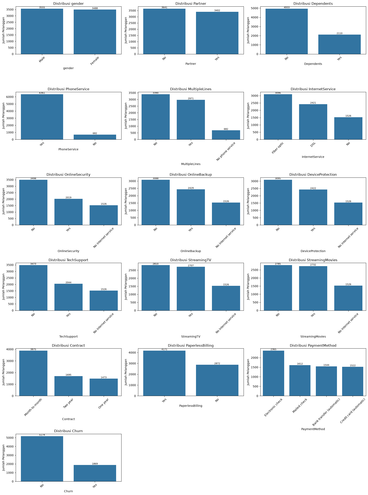
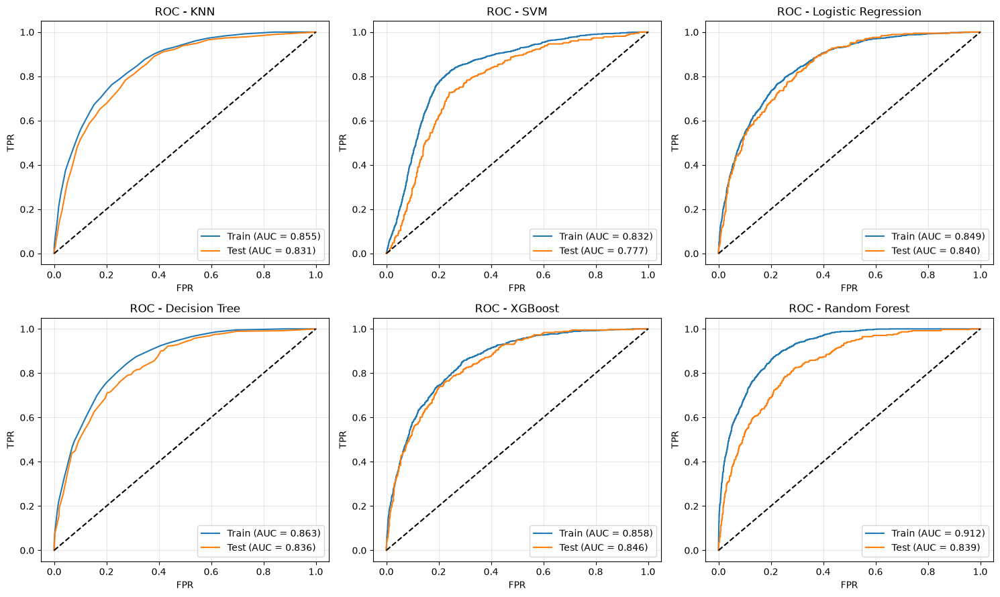
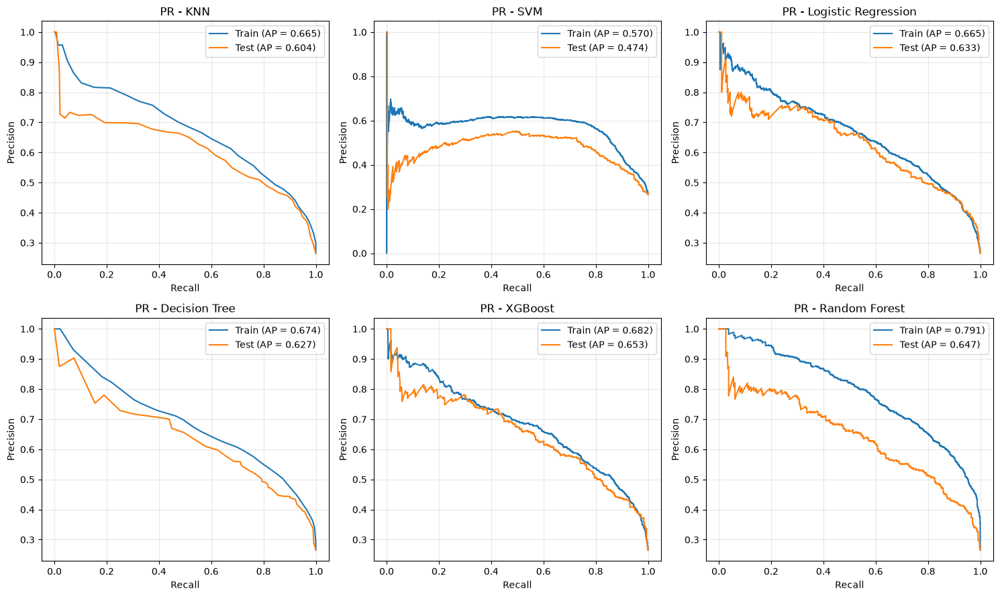
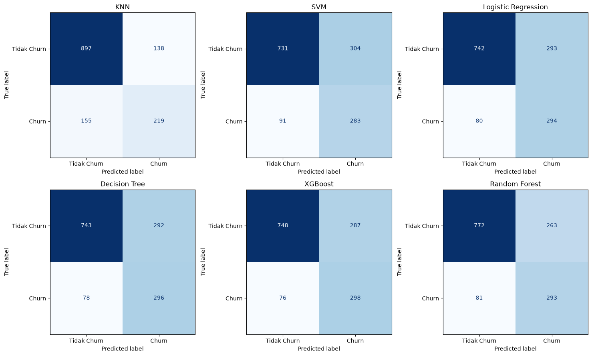
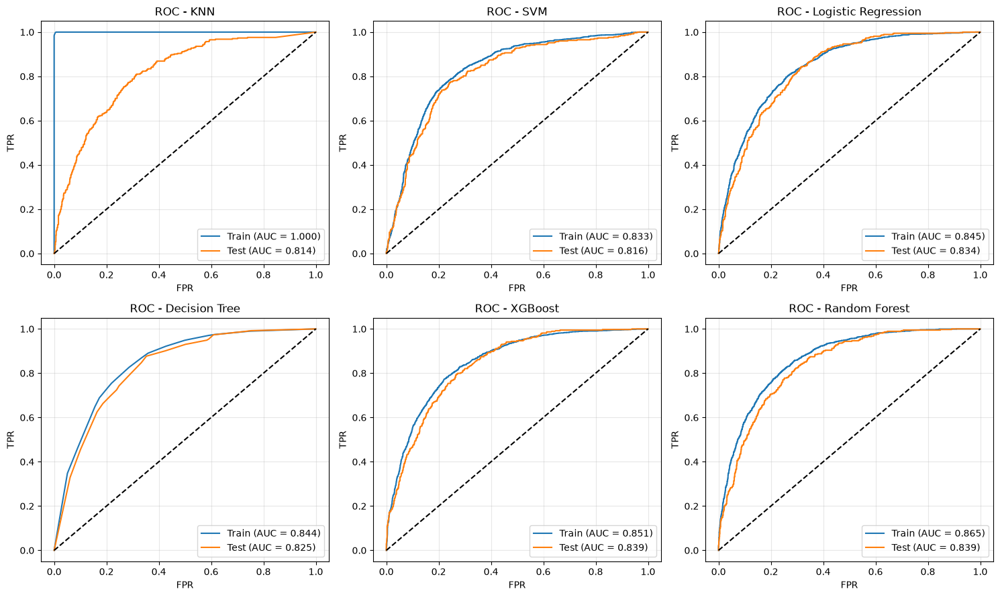
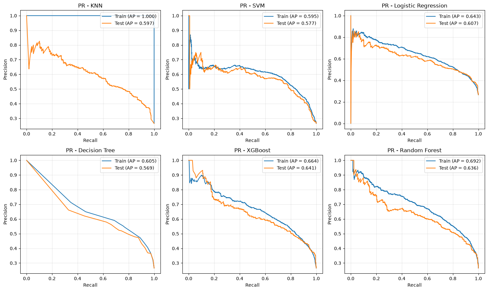
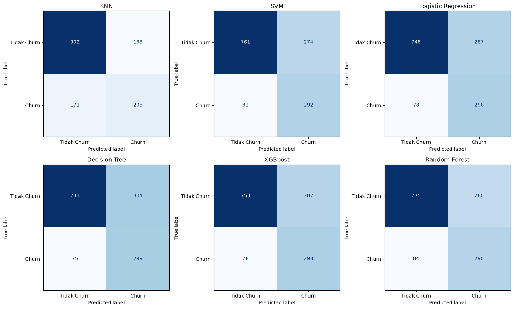
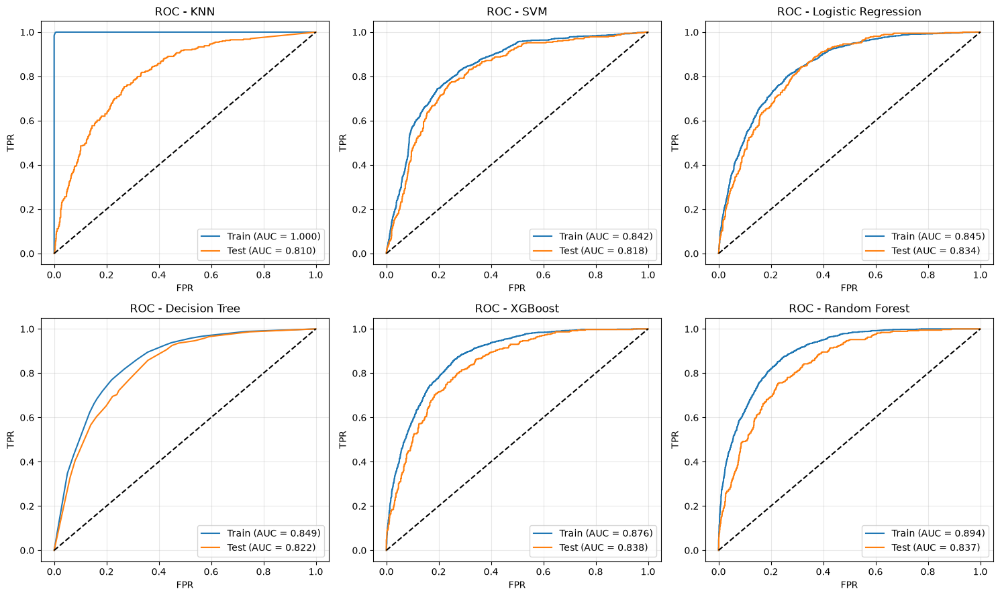
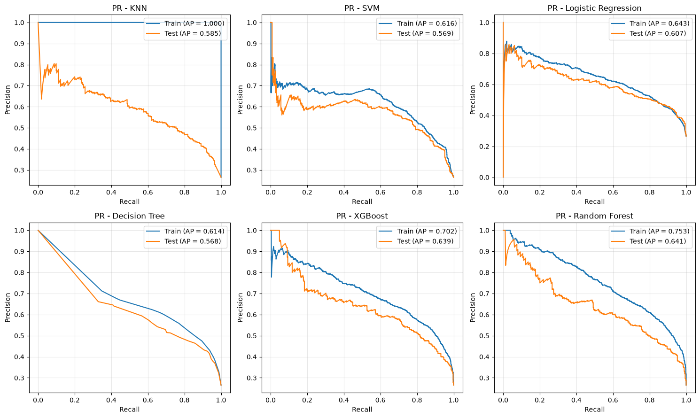
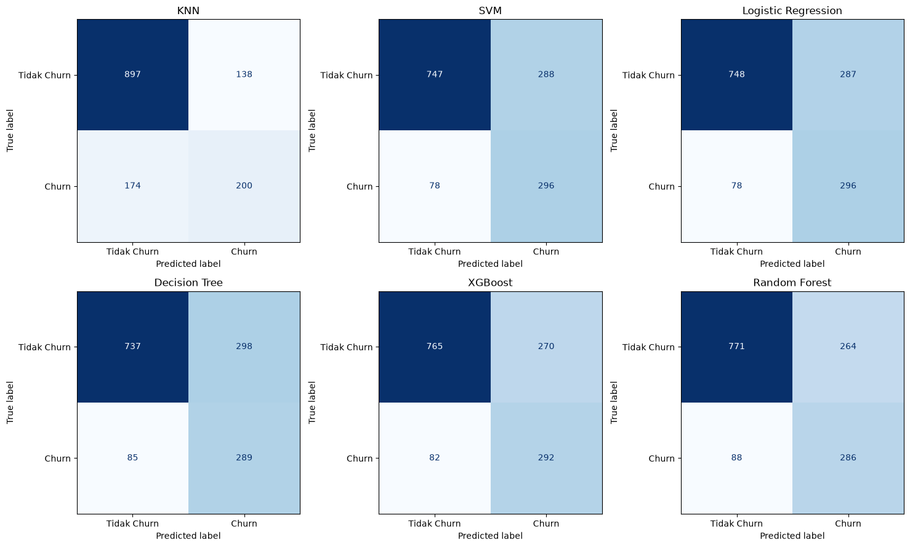

# Laporan Proyek: Prediksi Customer Churn Telco

## 1. Ringkasan

Proyek ini membangun model klasifikasi untuk memprediksi pelanggan telekomunikasi yang berhenti berlangganan (*churn*) pada dataset IBM Telco Customer Churn (7.043 pelanggan). Enam algoritma dibandingkan pada tiga skenario fitur.

Jawaban atas rumusan masalah (detail di Bagian 6):

| Pertanyaan | Jawaban singkat |
|---|---|
| Bagaimana karakteristik pelanggan churn? | Cenderung berkontrak bulanan, memakai fiber optic, membayar dengan electronic check, dan baru berlangganan (0-12 bulan). |
| Faktor apa yang berkaitan dengan churn? | Jenis kontrak, lama berlangganan, jenis internet, metode pembayaran, dan ada tidaknya layanan proteksi. |
| Bagaimana kinerja model? | ROC-AUC test 0,81 sampai 0,85 dan AP 0,47 sampai 0,65, dengan recall churn sekitar 0,75 sampai 0,80 dan precision sekitar 0,50. |
| Model mana yang terbaik? | XGBoost, Random Forest, dan Logistic Regression hampir setara; tidak ada pemenang pasti. |

## 2. Data dan Persiapan

### 2.1 Dataset

7.043 baris dan 21 kolom: demografi (`gender`, `SeniorCitizen`, `Partner`, `Dependents`), layanan (telepon, internet, enam layanan tambahan), akun (`Contract`, `PaperlessBilling`, `PaymentMethod`, `tenure`, `MonthlyCharges`, `TotalCharges`), dan target `Churn`. `customerID` hanya pengenal dan tidak dipakai sebagai fitur. Sumber: [Kaggle](https://www.kaggle.com/datasets/blastchar/telco-customer-churn).

### 2.2 Pembersihan data (notebook 03)

| Pemeriksaan | Temuan | Tindakan |
|---|---|---|
| Tipe data | `TotalCharges` terbaca teks | Diubah ke numerik (`errors="coerce"`) |
| Nilai kosong | 11 nilai `TotalCharges` kosong | Diimputasi di dalam pipeline setelah split, untuk mencegah kebocoran data |
| Duplikasi | 0 baris duplikat | - |
| Konsistensi kategori | Tidak ada salah ketik | - |
| Outlier | Dicek dengan boxplot dan aturan IQR | Lihat catatan di Bagian 7 |

### 2.3 Pembagian data (notebook 04 dan 07)

Data dibagi 80:20 dengan `stratify=y` dan `random_state=42`. Proporsi churn sama di kedua bagian (26,54%).

| Bagian | Jumlah | Tidak churn | Churn |
|---|---|---|---|
| Train | 5.634 | 4.139 | 1.495 |
| Test | 1.409 | 1.035 | 374 |

Rasio kelas 2,77 : 1. Skenario fitur yang berbeda memakai split yang sama (diverifikasi: baris yang sama di kedua split), sehingga perbandingan antar phase adil.

## 3. Eksplorasi Data

Kelas tidak seimbang: 73,46% tidak churn dan 26,54% churn. Karena itu akurasi tidak dijadikan acuan (menebak semua "tidak churn" sudah menghasilkan akurasi sekitar 0,735).

Tingkat churn per kelompok (dihitung dari data mentah):

| Variabel | Kelompok | Tingkat churn |
|---|---|---|
| `Contract` | Month-to-month / One year / Two year | 42,7% / 11,3% / 2,8% |
| `InternetService` | Fiber optic / DSL / No | 41,9% / 19,0% / 7,4% |
| `PaymentMethod` | Electronic check / Mailed check / Bank transfer (auto) / Credit card (auto) | 45,3% / 19,1% / 16,7% / 15,2% |
| Lama berlangganan | 0-12 / 13-24 / 25-48 / 49+ bulan | 47,4% / 28,7% / 20,4% / 9,5% |
| `OnlineSecurity` | Tidak / Ya | 41,8% / 14,6% |
| `TechSupport` | Tidak / Ya | 41,6% / 15,2% |
| `PaperlessBilling` | Ya / Tidak | 33,6% / 16,3% |
| `SeniorCitizen` | Senior / Non-senior | 41,7% / 23,6% |

Median `tenure` pelanggan churn 10 bulan (tidak churn 38 bulan), dan median `MonthlyCharges` churn 79,65 (tidak churn 64,43).

> Hubungan di atas bersifat asosiasi, bukan sebab-akibat.

## 4. Desain Eksperimen

Tiga skenario fitur dibandingkan dengan pengaturan yang sama.

| Komponen | Pengaturan |
|---|---|
| Algoritma | KNN, SVM, Logistic Regression, Decision Tree, XGBoost, Random Forest |
| Imbalance | `class_weight='balanced'` (SVM, Logistic Regression, Decision Tree, Random Forest), `scale_pos_weight=2,77` (XGBoost) |
| Pipeline | `jcopml` (`num_pipe`, `cat_pipe`) di dalam `Pipeline` sklearn |
| Tuning | `RandomizedSearchCV`, 50 kombinasi, 5-fold CV, `scoring='f1'` |
| Metrik utama | ROC-AUC dan AP (tidak bergantung threshold), ditambah precision, recall, F1 pada threshold 0,5 |

| Phase | Notebook | Fitur | Perbedaan |
|---|---|---|---|
| 1 | 05 | 19 fitur asli | Baseline |
| 2 | 06-08 | 10 fitur hasil seleksi dan rekayasa | Penyederhanaan fitur |
| 3 | 09 | Fitur Phase 2 | Ditambah `PolynomialFeatures` pada fitur numerik (ruang parameter `*_poly_params`) |

## 5. Hasil Eksperimen

Semua angka di bawah dihitung pada data test, kecuali kolom CV. F1 CV adalah rata-rata 5-fold dari pencarian parameter terbaik. "Gap AP" adalah AP train dikurangi AP test (indikator overfitting).

### 5.1 Phase 1: 19 fitur asli

Preprocessing: `tenure`, `MonthlyCharges`, `TotalCharges` diimputasi median dan distandardisasi; variabel kategorik di-one-hot encoding. *Permutation importance* menunjukkan `Contract`, `tenure`, dan `InternetService` paling berpengaruh; `MonthlyCharges`, `TotalCharges`, dan `PaymentMethod` berpengaruh sedang.

| Model | F1 CV | F1 Test | ROC-AUC | AP | Gap AP |
|---|---|---|---|---|---|
| XGBoost | 0,639 | 0,621 | 0,846 | 0,654 | 0,029 |
| Random Forest | 0,640 | 0,630 | 0,839 | 0,647 | 0,144 |
| Logistic Regression | 0,632 | 0,612 | 0,840 | 0,633 | 0,033 |
| Decision Tree | 0,625 | 0,615 | 0,836 | 0,627 | 0,046 |
| KNN | 0,610 | 0,599 | 0,831 | 0,604 | 0,061 |
| SVM | 0,622 | 0,589 | 0,777 | 0,474 | 0,096 |

Random Forest overfit cukup jelas (gap AP 0,144), dan SVM paling lemah pada ROC-AUC dan AP.

### 5.2 Phase 2: 10 fitur hasil rekayasa

Hanya sebagian variabel yang berpengaruh pada Phase 1, sementara kolom lain saling tumpang tindih. Fitur baru dibuat dengan prinsip **satu informasi, satu fitur**.

| Fitur | Pembuatan | Alasan |
|---|---|---|
| `tenure_bin` | `tenure` dikelompokkan: 0-12, 13-24, 25-48, 49+ bulan | Risiko churn tertinggi di tahun pertama dan tidak linear |
| `charge_diff` | `TotalCharges - tenure × MonthlyCharges` | Menangkap perubahan tagihan selama berlangganan |
| `n_protection` | Jumlah layanan proteksi (OnlineSecurity, OnlineBackup, DeviceProtection, TechSupport) | Mengukur keterikatan dengan layanan pendukung |
| `n_streaming` | Jumlah layanan streaming (StreamingTV, StreamingMovies) | Dipisah dari proteksi karena sifatnya berbeda |
| `is_echeck` | 1 jika `PaymentMethod` = Electronic check | Metode dengan churn tertinggi |
| `has_family` | 1 jika punya `Partner` atau `Dependents` | Menggabungkan dua variabel lemah |

| Informasi | Dipakai | Tidak dipakai |
|---|---|---|
| Lama berlangganan | `tenure_bin` | `tenure` |
| Biaya | `MonthlyCharges`, `charge_diff` | `TotalCharges` |
| Layanan tambahan | `n_protection`, `n_streaming` | Kolom layanan asli |
| Pembayaran | `is_echeck` | `PaymentMethod` |
| Keluarga | `has_family` | `Partner`, `Dependents` |

`gender`, `SeniorCitizen`, `PhoneService`, dan `MultipleLines` tidak dipakai karena importance mendekati nol pada Phase 1 (lihat catatan `SeniorCitizen` di Bagian 7). Fitur akhir (10): `Contract`, `tenure_bin`, `InternetService`, `MonthlyCharges`, `charge_diff`, `n_protection`, `n_streaming`, `is_echeck`, `has_family`, `PaperlessBilling`. Seluruh fitur dihitung per baris tanpa statistik dari seluruh data, sehingga tidak menimbulkan kebocoran data.

| Model | F1 CV | F1 Test | ROC-AUC | AP | Gap AP |
|---|---|---|---|---|---|
| XGBoost | 0,635 | 0,625 | 0,839 | 0,641 | 0,023 |
| Random Forest | 0,632 | 0,628 | 0,839 | 0,636 | 0,056 |
| Logistic Regression | 0,631 | 0,619 | 0,834 | 0,607 | 0,036 |
| KNN | 0,578 | 0,572 | 0,814 | 0,597 | 0,403 |
| SVM | 0,623 | 0,621 | 0,816 | 0,577 | 0,018 |
| Decision Tree | 0,626 | 0,612 | 0,825 | 0,569 | 0,036 |

### 5.3 Phase 3: Phase 2 + polynomial features

Ruang pencarian ditambah `degree` dan `interaction_only` pada fitur numerik.

| Model | F1 CV | F1 Test | ROC-AUC | AP | Gap AP |
|---|---|---|---|---|---|
| XGBoost | 0,634 | 0,624 | 0,838 | 0,639 | 0,063 |
| Random Forest | 0,632 | 0,619 | 0,838 | 0,641 | 0,112 |
| Logistic Regression | 0,631 | 0,619 | 0,834 | 0,607 | 0,036 |
| SVM | 0,620 | 0,618 | 0,818 | 0,569 | 0,048 |
| Decision Tree | 0,623 | 0,601 | 0,822 | 0,568 | 0,047 |
| KNN | 0,571 | 0,562 | 0,810 | 0,586 | 0,414 |

Pencarian umumnya memilih `degree=1` (tanpa interaksi tambahan). XGBoost memilih `degree=3`, tetapi tidak memberi peningkatan.

### 5.4 Perbandingan antar phase

| Model | ROC-AUC (P1 / P2 / P3) | AP (P1 / P2 / P3) |
|---|---|---|
| XGBoost | 0,846 / 0,839 / 0,838 | 0,654 / 0,641 / 0,639 |
| Random Forest | 0,839 / 0,839 / 0,838 | 0,647 / 0,636 / 0,641 |
| Logistic Regression | 0,840 / 0,834 / 0,834 | 0,633 / 0,607 / 0,607 |
| Decision Tree | 0,836 / 0,825 / 0,822 | 0,627 / 0,569 / 0,568 |
| KNN | 0,831 / 0,814 / 0,810 | 0,604 / 0,597 / 0,586 |
| SVM | 0,777 / 0,816 / 0,818 | 0,474 / 0,577 / 0,569 |

## 6. Pembahasan dan Kesimpulan

1. **Model teratas hampir setara.** XGBoost, Random Forest, dan Logistic Regression berselisih ROC-AUC sekitar 0,01 atau kurang di setiap phase. Dengan 374 kasus churn di test set, selisih sekecil itu masih dalam batas variasi sampel. Pemilihan akhir sebaiknya berdasarkan stabilitas dan kemudahan interpretasi: Logistic Regression memiliki gap train-test kecil (gap AP 0,033 sampai 0,036) dan koefisiennya mudah ditafsirkan.
2. **Rekayasa fitur dan polynomial tidak meningkatkan performa.** ROC-AUC dan AP tertinggi justru pada Phase 1 (XGBoost 0,846 dan 0,654). Manfaat Phase 2 adalah penyederhanaan, yaitu 10 fitur menggantikan 19 dengan penurunan skor sekitar 0,01 (dalam batas variasi). Polynomial tidak memberi tambahan karena pencarian memilih `degree=1`.
3. **KNN overfit pada Phase 2 dan 3.** F1 train 0,993 vs test sekitar 0,57 akibat `weights='distance'`. SVM menghasilkan `ConvergenceWarning` (solver berhenti di `max_iter=5000`) dan paling lemah pada AP di Phase 1.
4. **F1 pada threshold 0,5 kurang cocok untuk memilih model.** Pada Phase 1, SVM terlihat sebanding pada CV F1 (0,622) tetapi memiliki ROC-AUC 0,777, jauh di bawah model lain. Karena itu ROC-AUC dan AP dipakai sebagai dasar perbandingan.
5. **Trade-off precision dan recall.** Model dengan `class_weight` mencapai recall churn sekitar 0,75 sampai 0,80 dengan precision sekitar 0,50: sebagian besar pelanggan yang akan churn tertangkap, dengan konsekuensi banyak peringatan yang keliru. Titik operasi dapat diatur lewat threshold sesuai biaya intervensi.

**Implikasi bisnis.** Pelanggan baru (0-12 bulan) dengan kontrak bulanan, internet fiber optic, pembayaran electronic check, dan tanpa layanan keamanan atau dukungan teknis berada pada kelompok berisiko tinggi. Intervensi yang mungkin dipertimbangkan: penawaran kontrak jangka panjang, program onboarding bagi pelanggan baru, dan dorongan beralih ke pembayaran otomatis. Karena hubungan ini bersifat asosiatif, efektivitas intervensi perlu diuji terlebih dahulu.

## 7. Keterbatasan dan Catatan Audit

- **`SeniorCitizen` ter-clip menjadi 0.** Pada notebook 03, penanganan outlier IQR diterapkan pada `SeniorCitizen` (variabel biner). Karena Q1 = Q3 = 0, seluruh nilainya menjadi 0 (1.142 pelanggan senior hilang informasinya). Akibatnya importance `SeniorCitizen` pada Phase 1 bukan temuan yang valid, dan alasan membuangnya pada Phase 2 perlu dikoreksi. Pengujian terpisah menunjukkan dampaknya ke skor sangat kecil (perubahan ROC-AUC sekitar 0,0004 pada model 10 fitur), tetapi penanganan ini sebaiknya diperbaiki dan seluruh notebook dijalankan ulang. Variabel numerik lain tidak memiliki outlier menurut aturan IQR.
- **Test set dipakai berulang** untuk membandingkan model antar phase, sehingga bukan estimasi yang sepenuhnya independen.
- **Pemilihan model memakai F1 pada threshold 0,5** (`scoring='f1'`).
- **Belum ada interval kepercayaan** untuk skor test.
- **`n_protection`** menggabungkan pelanggan tanpa internet dan pelanggan berinternet tanpa proteksi di nilai 0, sehingga hubungannya dengan churn tidak monoton (churn 29,8% pada nilai 0 dan 38,9% pada nilai 1).
- **`charge_diff`** bernilai kosong untuk pelanggan dengan `tenure = 0` dan diimputasi median di pipeline; nilai 0 lebih tepat karena pelanggan tersebut belum ditagih.
- **Dataset statis** tanpa dimensi waktu, sehingga model belum diuji terhadap perubahan perilaku pelanggan.

## 8. Rencana Phase 4

1. Perbaiki penanganan outlier `SeniorCitizen`, lalu jalankan ulang notebook 03 sampai 09.
2. Ablation fitur: `tenure_bin` vs `tenure` kontinu, `Contract` ordinal vs one-hot, `charge_diff` diisi 0, dan `n_protection` yang memisahkan pelanggan tanpa internet.
3. Tuning ulang dengan `scoring='average_precision'` dan cross-validation berulang.
4. Perbandingan penanganan imbalance: tanpa pembobotan, `class_weight`, dan random oversampling (di dalam `imblearn.pipeline.Pipeline`).
5. Optimasi threshold dari prediksi *out-of-fold* di data train, bukan di test.
6. Evaluasi test sekali, disertai *bootstrap confidence interval* untuk ROC-AUC, AP, precision, dan recall.
7. Analisis kesalahan prediksi dan interpretasi model akhir (odds ratio untuk Logistic Regression, permutation importance untuk model pohon).
